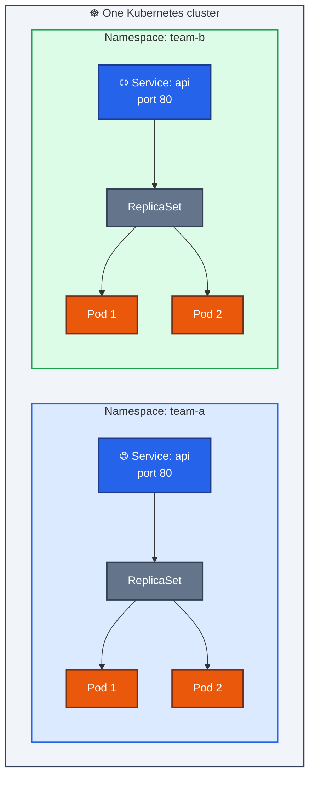

# Kubernetes Namespaces

A **namespace** lets different applications, teams or projects **share one Kubernetes cluster** without getting in each other's way.

Think of a cluster as an office building and namespaces as separate rooms. Everyone uses the same building, but each team works in its own room.



Both namespaces have a Service called `api` on port 80. That's fine, because names only have to be unique **inside** a namespace.

---

## Why use namespaces?

- **Keep things separate** by team, project or environment (`dev`, `qa`, `stage`, `prod`).
- **Same names allowed** in different namespaces, so two teams can each have a Service called `api`.
- **Access control**: give a team permission only for its own namespace.
- **Resource limits**: cap how much CPU and memory a namespace can use, so one team can't eat up the whole cluster.
- **Easy cleanup**: deleting a namespace deletes everything inside it.

> Real example: in non-prod, each team gets its own namespace. In stage and prod, all apps share one common namespace.

---

## Namespaces that already exist

Every cluster starts with these:

| Namespace | What's in it |
|---|---|
| `default` | Where your stuff goes if you don't name a namespace. |
| `kube-system` | Kubernetes' own components (DNS, kube-proxy, etc.). Don't touch unless you know why. |
| `kube-public` | Readable by everyone, rarely used. |
| `kube-node-lease` | Node heartbeats, used internally to check if nodes are alive. |

---

## Creating a namespace

### Way 1: With a command

```bash
kubectl get ns              # list namespaces (ns = short for namespaces)
kubectl create ns dev       # create a namespace called "dev"
```

### Way 2: With a YAML file

```yaml
# nsdev.yaml
apiVersion: v1
kind: Namespace
metadata:
  name: dev
```

```bash
kubectl apply -f nsdev.yaml
```

> `kubectl create -f` works too, but it fails if the namespace already exists.
> `kubectl apply -f` creates it the first time and updates it after that, so it's the better habit.

---

## Working inside a namespace

```bash
kubectl get pods -n dev                      # pods in "dev"
kubectl get pods -A                          # pods in all namespaces
kubectl apply -f app.yaml -n dev             # deploy into "dev"

# Make "dev" your default so you don't need -n every time
kubectl config set-context --current --namespace=dev

kubectl delete ns dev                        # ⚠️ deletes EVERYTHING inside it
```

You can also put the namespace in the YAML itself:

```yaml
metadata:
  name: myapi
  namespace: dev
```

---

## Talking across namespaces

Inside the same namespace, a Pod can call a Service just by its name:

```
http://api
```

To call a Service in **another** namespace, add the namespace name:

```
http://api.team-b
http://api.team-b.svc.cluster.local   # full name
```

Namespaces separate **names**, not the **network**. By default, Pods in different namespaces can still talk to each other. To block that, you need a **NetworkPolicy**.

---

## Not everything lives in a namespace

Some things belong to the whole cluster, not to any namespace:

- **Nodes**
- **PersistentVolumes**
- **Namespaces** themselves
- **StorageClasses**, **ClusterRoles**

```bash
kubectl api-resources --namespaced=false   # see the full list
```

---

## A note on the slide

The slide says **ReplicationSet / Replication Controller**. The correct name is **ReplicaSet**. **ReplicationController** is the old version, and nobody uses it in new projects. Today you create a **Deployment**, and the Deployment creates and manages the ReplicaSet for you.

---

## In one line

A namespace is a separate room inside one cluster. It keeps names, permissions and resource limits apart, but it doesn't block network traffic by default.

See also: [Kubernetes Basic Concepts](./kubernetes-basic-concepts.md) · [Kubernetes Cluster Components](./kubernetes-cluster-components.md)
