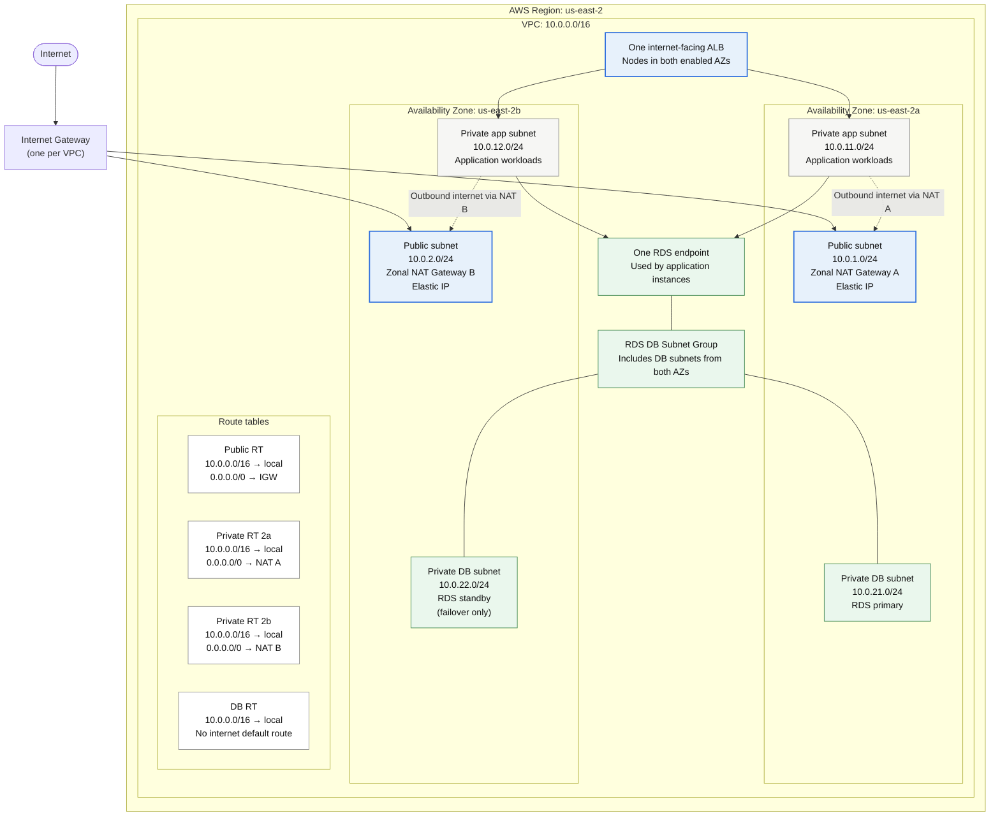

# AWS VPC — Part 2: VPC in Production

This part covers security, connectivity, a production reference architecture, AWS vs GCP networking, and interview questions. It builds on [Part 1: Fundamentals](./aws-vpc-part-1-fundamentals.md).

> **Learning goal:** Understand how to design a VPC for a production application with public, private application, and private database tiers across multiple Availability Zones (AZs).

## 6. Beyond the basics: what you need on the job

### Security Group vs Network ACL (NACL)

| Feature | Security Group (SG) | Network ACL (NACL) |
|---|---|---|
| Attached to | Network interface (ENI) / resource | Subnet |
| State | **Stateful:** response traffic is automatically allowed | **Stateless:** inbound and outbound rules are evaluated separately |
| Rules | Allow rules only | Allow and deny rules |
| Rule evaluation | All applicable allow rules are evaluated | Rules are evaluated in rule-number order; first match wins |
| Default | A new security group has no inbound rules and allows all outbound traffic by default | Default NACL allows all inbound and outbound traffic; a new custom NACL denies traffic until rules are added |
| Typical use | Primary resource-level firewall. For example, allow DB traffic from `app-sg` only | Coarse subnet-level guardrail, for example, explicitly deny a known IP range |

**Example:**

- Application Security Group (`app-sg`): allow inbound HTTPS from the ALB security group.
- Database Security Group (`db-sg`): allow inbound database traffic only from `app-sg`.
- Do not open the database port to `0.0.0.0/0`.

**Important:** Because NACLs are stateless, you must allow the required return traffic explicitly. For many client connections, this includes ephemeral ports. `1024–65535` is a commonly used broad example, but the exact range depends on the client and operating system.

### NAT Gateway in detail

A NAT Gateway allows resources in a private subnet to initiate outbound connections to the internet. It does not allow unsolicited inbound connections from the internet.

AWS provides two availability modes:

#### 1. Zonal NAT Gateway

- A zonal NAT Gateway is created in a specific Availability Zone and hosted in a **public subnet**.
- For internet egress, it uses an Elastic IP address.
- The public subnet's route table must have a route to the Internet Gateway (`0.0.0.0/0 → IGW`).
- The private subnet's route table sends internet-bound traffic to the NAT Gateway (`0.0.0.0/0 → NAT GW`).
- A zonal NAT Gateway is associated with one AZ. If that AZ becomes unavailable, workloads in other AZs that depend on it can lose outbound connectivity.

**Traditional high-availability design:** Create one zonal NAT Gateway per AZ and configure each private subnet to use the NAT Gateway in its own AZ. This avoids cross-AZ dependency for normal internet egress.

#### 2. Regional NAT Gateway

AWS also offers a **Regional NAT Gateway**:

- It automatically expands across supported AZs based on workload presence.
- You do not need to create a public subnet to host it.
- Private subnets can route traffic to the same Regional NAT Gateway resource.
- It simplifies the traditional setup, where you create and manage a separate zonal NAT Gateway in each AZ.
- Regional NAT Gateways do not support private NAT use cases; use a zonal NAT Gateway when private NAT is required.

> **Diagram note:** The production architecture later in this document shows the traditional *zonal NAT Gateway* design. It is still a valid and commonly understood architecture. It is not the only NAT Gateway option anymore.

#### NAT Gateway cost considerations

- NAT Gateways are charged per hour and per GB processed. Check current pricing for your Region.
- Traffic to S3 or DynamoDB can often use a **Gateway VPC Endpoint** instead of going through NAT.
- For ECR image pulls, use the required ECR interface endpoints (`ecr.api` and `ecr.dkr`) together with an S3 gateway endpoint for image layers, where applicable.
- Review VPC Flow Logs, NAT Gateway metrics, and application traffic patterns to identify unnecessary NAT data processing.

#### NAT Instance

A NAT Instance is an EC2 instance configured to perform network address translation.

- It is self-managed: you handle patching, scaling, monitoring, and failover.
- It can offer more customization, but requires more operational work.
- NAT Instances are generally more suitable for labs or specialized requirements than a standard production design.

### VPC Endpoints: access AWS services privately

VPC Endpoints allow resources in a VPC to connect to supported AWS services without requiring an internet gateway or NAT Gateway for that service traffic.

| Endpoint type | Used for | How it works |
|---|---|---|
| Gateway Endpoint | S3 and DynamoDB | Adds a route-table entry. No additional endpoint hourly or data-processing charge. |
| Interface Endpoint (AWS PrivateLink) | Many other AWS services, such as ECR, SSM, Secrets Manager, and CloudWatch Logs | Creates an endpoint network interface (ENI) in selected subnets. Pricing generally includes hourly and data-processing charges. |

**Example:** An EC2 instance in a private subnet can access S3 through an S3 Gateway Endpoint without sending that traffic through a NAT Gateway.

**Remember:** An endpoint provides private connectivity to a supported service. You still need the correct endpoint policy, IAM permissions, security group rules (for interface endpoints), DNS configuration, and service-specific permissions.

### VPC Peering

VPC Peering connects two VPCs privately so resources can communicate using private IP addresses.

It works across AWS accounts and can also connect VPCs in different Regions, subject to AWS configuration requirements.

Rules to remember:

- **CIDRs must not overlap.** For example, two VPCs cannot both use `10.0.0.0/16`.
- **Peering is not transitive.** If A is peered with B, and B is peered with C, A cannot automatically communicate with C. You need a direct A-to-C peering connection or another network design.
- **Routes are required on both sides.** Each VPC's relevant route table needs a route to the peer VPC CIDR with the peering connection as the target.
- **Security rules must allow the traffic.** Update Security Groups and NACLs as required.
- **No edge-to-edge routing:** A VPC cannot use a peer VPC's Internet Gateway, NAT Gateway, VPN, or Direct Connect connection as its own network exit.
- **Many VPCs?** Consider AWS Transit Gateway for a hub-and-spoke design instead of maintaining a large mesh of peering connections.

### Other things to know

- **VPC Flow Logs:** Capture information about IP traffic to and from network interfaces in a VPC, subnet, or ENI. They can help investigate accepted and rejected traffic. They are useful for troubleshooting, but they do not replace Security Group/NACL inspection or VPC Reachability Analyzer.
- **DNS settings:** `enableDnsSupport` controls whether DNS resolution is supported in the VPC. `enableDnsHostnames` controls whether instances with public IPv4 addresses receive public DNS hostnames. Private hosted zones and interface endpoint private DNS also require the appropriate VPC DNS settings.
- **Elastic IP (EIP):** A static public IPv4 address that you allocate to your AWS account. AWS charges for public IPv4 addresses, including Elastic IPs, subject to the current pricing rules. Release unused addresses.
- **IPv6:** IPv6 addresses are globally unique, but that does not automatically mean a resource is reachable. Routing and Security Group/NACL rules still control access. For outbound-only IPv6 internet access from private subnets, use an **Egress-Only Internet Gateway**.
- **Bastion host:** A hardened instance in a public subnet that administrators use to access private instances. AWS Systems Manager Session Manager can often replace the need for a bastion host.
- **Multi-AZ design:** A public subnet in one AZ and an application subnet in another AZ is not a highly available design. For high availability, spread the load balancer and application workloads across at least two AZs. Add database subnets in multiple AZs when using RDS Multi-AZ.
- **Load balancer pattern:** An internet-facing Application Load Balancer (ALB) is associated with public subnets in multiple AZs. Application instances or nodes are placed in private application subnets. Internet clients access the application through the ALB; application instances should not be directly exposed to the internet.
- **Subnet tiers:** Public, private application, and private database subnets are common production patterns. Separate tiers when they need different routing, security, or operational boundaries. A subnet does not replace Security Groups; use both.

## 7. Production reference architecture

This is a common three-tier VPC design for a production application. It uses two Availability Zones for high availability.

Each AZ has:

1. A **public subnet** for the ALB nodes and a zonal NAT Gateway.
2. A **private application subnet** for EC2 instances, ECS tasks, or EKS nodes/workloads, depending on the design.
3. A **private database subnet** for RDS.

The example uses:

- Region: `us-east-2`
- VPC CIDR: `10.0.0.0/16`
- Two Availability Zones: `us-east-2a` and `us-east-2b`
- One internet-facing ALB associated with both public subnets
- One traditional zonal NAT Gateway in each AZ
- One RDS Multi-AZ DB instance deployment, with a primary and a standby

### Architecture diagram



### Important points about this diagram

- **One ALB, two AZs:** This is one ALB associated with both public subnets. AWS creates load balancer nodes in the enabled AZs; it is not two separate ALBs.
- **NAT Gateways:** This diagram shows the traditional zonal NAT design. Each private application subnet uses the NAT Gateway in its own AZ for normal internet egress.
- **RDS endpoint:** Both application instances connect to the same RDS endpoint. Do not configure App A to connect directly to the primary and App B to connect directly to the standby.
- **RDS Multi-AZ DB instance deployment:** The standby provides high availability and failover; it does not serve read traffic. RDS updates the DB endpoint during failover. Applications should reconnect and handle transient connection failures.
- **Read scaling:** If you need read traffic distributed to other database instances, consider RDS read replicas or an RDS Multi-AZ DB cluster, depending on the database engine and requirements. A Multi-AZ DB cluster has reader instances that can serve read traffic.
- **DB subnet group:** The RDS DB subnet group is a logical grouping of subnets in multiple AZs. RDS uses it to place the DB deployment. It is not a separate subnet or route table.
- **DB security:** Configure the DB Security Group to allow the database port only from the application Security Group. For example, allow TCP `5432` from `app-sg` for PostgreSQL. Use the correct port for your database engine.
- **DB route table:** The DB subnets have the VPC local route but no default route to an Internet Gateway or NAT Gateway. The local route still allows permitted communication with application subnets inside the VPC.
- **Route tables:** Each subnet is associated with one route table. A subnet without an explicit association uses the VPC's main route table.

### Route table summary

| Route table | Routes | Associated subnets |
|---|---|---|
| Public RT | `10.0.0.0/16 → local`; `0.0.0.0/0 → IGW` | Public subnet A and public subnet B |
| Private RT 2a | `10.0.0.0/16 → local`; `0.0.0.0/0 → NAT A` | Private application subnet A |
| Private RT 2b | `10.0.0.0/16 → local`; `0.0.0.0/0 → NAT B` | Private application subnet B |
| DB RT | `10.0.0.0/16 → local`; no internet default route | DB subnet A and DB subnet B |

**Remember:** The route table controls where traffic is routed. A route to an Internet Gateway alone does not make an EC2 instance reachable from the internet. For direct IPv4 internet connectivity, the instance also needs a public IPv4 address or Elastic IP, and its Security Group and NACL must allow the required traffic.

### Clean up after practice builds

AWS resources can continue to incur charges after a lab.

For a practice VPC, review and delete resources you no longer need, such as:

1. Terminate EC2 instances and remove other test workloads.
2. Delete NAT Gateways after checking that nothing depends on them.
3. Release unused Elastic IP addresses.
4. Delete load balancers and other billable resources.
5. Detach and delete the Internet Gateway.
6. Delete subnets, custom route tables, and the VPC when it is no longer needed.

Check dependencies before deleting resources. In real projects, use Infrastructure as Code (for example, Terraform or AWS CloudFormation) to create and manage infrastructure consistently.

## 8. AWS VPC vs GCP VPC

If you also work on Google Cloud (for example, GKE), the networking concepts are similar, but some important details differ.

| Concept | AWS | Google Cloud (GCP) |
|---|---|---|
| VPC scope | Regional | Global, across Regions |
| Subnet scope | One Availability Zone | Regional; spans the zones in that Region |
| Reserved IPv4 addresses per subnet | 5 | 4 |
| Resize subnet | Cannot change an existing subnet's CIDR block; create another subnet or plan carefully | Can expand a primary subnet IP range, subject to constraints |
| Internet access | Internet Gateway attached to the VPC plus route-table configuration | Routes use the default internet gateway next hop; there is no separate IGW resource to attach |
| Outbound internet for private workloads | NAT Gateway (zonal or Regional) | Cloud NAT, configured using a regional Cloud Router |
| Firewall | Security Groups (resource/ENI level) and NACLs (subnet level) | VPC firewall rules and firewall policies, commonly targeted using network tags or service accounts |
| Private access to cloud services | VPC Endpoints | Private Google Access and Private Service Connect, depending on the service and use case |
| Connect networks | VPC Peering (non-transitive), Transit Gateway | VPC Network Peering (non-transitive), Shared VPC, Network Connectivity Center |
| Kubernetes networking | EKS commonly uses VPC IP addresses for nodes and, depending on networking mode, pods | GKE VPC-native clusters use alias IP ranges; Pod and Service ranges are secondary IP ranges associated with the subnet |

### Things to check in a GKE setup

- Which VPC and subnet does the cluster use?
- Which secondary IP ranges are allocated for Pods and Services?
- Are nodes private (without external IP addresses)?
- Is Cloud NAT configured for required outbound internet access?
- Do firewall rules allow the required load balancer health checks and application traffic?

## 9. Interview questions

### 1. What makes a subnet public?

A subnet is considered public when its associated route table has a route to an Internet Gateway, for example:

```text
0.0.0.0/0 → IGW
```

For an EC2 instance to have direct IPv4 internet connectivity, it also needs a public IPv4 address or Elastic IP, and the Security Group and NACL must allow the required traffic.

**Interview tip:** The route table determines whether the subnet is public; a public IP and security rules determine whether a particular instance can use that connectivity.

### 2. How can a private EC2 instance download software updates?

The private subnet's route table sends internet-bound traffic to a NAT Gateway:

```text
0.0.0.0/0 → NAT Gateway
```

The NAT Gateway provides outbound connectivity. Unsolicited inbound connections from the internet are not allowed through the NAT Gateway.

### 3. Why does an AWS `/24` subnet have 251 usable IPv4 addresses?

A `/24` contains 256 total IPv4 addresses.

AWS reserves 5 addresses in every IPv4 subnet:

- First address: network address.
- Second address: VPC router.
- Third address: Amazon-provided DNS.
- Fourth address: reserved for future use.
- Last address: reserved for network broadcast purposes.

Therefore:

```text
256 - 5 = 251 usable IPv4 addresses
```

### 4. What is the difference between a Security Group and a NACL?

- **Security Group:** Works at the resource/network-interface level, is stateful, and supports allow rules only.
- **NACL:** Works at the subnet level, is stateless, and supports both allow and deny rules evaluated in rule-number order.

### 5. VPC A is peered with VPC B, and VPC B is peered with VPC C. Can A communicate with C?

No. VPC Peering is not transitive.

You need a direct peering connection between A and C, or a suitable hub-and-spoke solution such as AWS Transit Gateway.

### 6. Can you peer `10.0.0.0/16` with another VPC using `10.0.0.0/16`?

No. The CIDR ranges overlap. VPC Peering requires non-overlapping IPv4 CIDR ranges.

### 7. Your NAT Gateway bill is very high. What would you investigate?

1. Check NAT Gateway metrics and billing data to understand traffic volume.
2. Use VPC Flow Logs to investigate traffic sources and destinations.
3. Check whether S3 and DynamoDB traffic can use Gateway Endpoints.
4. For ECR, check the ECR interface endpoints and S3 Gateway Endpoint configuration.
5. Review whether other AWS service traffic can use appropriate Interface Endpoints.
6. Check for unnecessary internet-bound traffic from private workloads.

### 8. Design a highly available three-tier application in AWS.

- Create a VPC with a planned CIDR range, for example `10.0.0.0/16`.
- Use at least two Availability Zones.
- In each AZ, create a public subnet, a private application subnet, and a private database subnet.
- Associate one internet-facing ALB with the public subnets across both AZs.
- Run application workloads in private application subnets.
- Use zonal NAT Gateways per AZ for traditional zonal outbound internet access, or evaluate a Regional NAT Gateway.
- Place RDS in a DB subnet group that includes private DB subnets across multiple AZs.
- Configure the DB Security Group to allow database traffic only from the application Security Group.
- Enable RDS Multi-AZ for high availability.

### 9. An EC2 instance cannot be reached. How would you troubleshoot?

Check in this order:

1. Does the instance have a public IPv4 address or Elastic IP, if direct internet access is expected?
2. Does the subnet's route table have `0.0.0.0/0 → IGW`?
3. Is the Internet Gateway attached to the VPC?
4. Does the Security Group allow the required inbound traffic?
5. Do the NACL inbound and outbound rules allow the traffic, including required return/ephemeral ports?
6. Is the OS firewall allowing the traffic?
7. Is the application/service running and listening on the expected IP and port?

Use **VPC Reachability Analyzer** and **VPC Flow Logs** to help identify network-level issues.

### 10. What is the AWS default VPC?

AWS creates a default VPC in each Region unless it has been deleted.

Common default VPC characteristics include:

- IPv4 CIDR: `172.31.0.0/16`.
- A default subnet in each Availability Zone in the Region.
- An Internet Gateway attached to the VPC.
- Default route-table and network configuration that supports internet connectivity for appropriately configured instances.

The default VPC is convenient for learning and quick testing. For production, design the VPC, subnet layout, routing, and security controls according to application requirements.

---

## Official AWS references

Use official documentation when checking current behavior and service limits.

- [Security groups](https://docs.aws.amazon.com/vpc/latest/userguide/vpc-security-groups.html)
- [Network ACLs](https://docs.aws.amazon.com/vpc/latest/userguide/vpc-network-acls.html)
- [NAT Gateways](https://docs.aws.amazon.com/vpc/latest/userguide/vpc-nat-gateway.html)
- [Regional NAT Gateways](https://docs.aws.amazon.com/vpc/latest/userguide/nat-gateways-regional.html)
- [VPC Endpoints](https://docs.aws.amazon.com/vpc/latest/privatelink/vpc-endpoints.html)
- [VPC Peering](https://docs.aws.amazon.com/vpc/latest/peering/what-is-vpc-peering.html)
- [VPC Flow Logs](https://docs.aws.amazon.com/vpc/latest/userguide/flow-logs.html)
- [Application Load Balancers](https://docs.aws.amazon.com/elasticloadbalancing/latest/application/application-load-balancers.html)
- [RDS Multi-AZ deployments](https://docs.aws.amazon.com/AmazonRDS/latest/UserGuide/Concepts.MultiAZ.html)
- [RDS DB subnet groups](https://docs.aws.amazon.com/AmazonRDS/latest/UserGuide/USER_VPC.WorkingWithRDSInstanceinaVPC.html)
- [GKE VPC-native clusters](https://cloud.google.com/kubernetes-engine/docs/concepts/alias-ips)

---

**Previous:** [Part 1: VPC Fundamentals](./aws-vpc-part-1-fundamentals.md)
