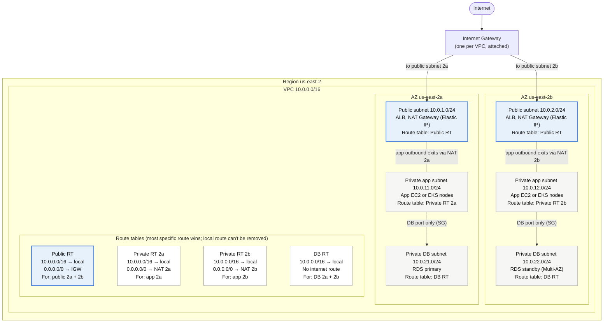

# AWS VPC — Part 2: VPC in production

This part covers security, connectivity, a production reference architecture, the GCP equivalents and interview questions. It builds on [Part 1: Fundamentals](./aws-vpc-part-1-fundamentals.md).

## 6. Beyond the basics: what you need on the job

### Security Group vs NACL

|  | Security Group | Network ACL |
| --- | --- | --- |
| Attached to | Instance / ENI | Subnet |
| State | Stateful: return traffic allowed automatically | Stateless: allow return traffic yourself (ephemeral ports 1024–65535) |
| Rules | Allow only | Allow and deny, evaluated lowest number first |
| Default | New SG: no inbound, all outbound | Default NACL: allow all both ways. A new custom NACL denies everything until you add rules |
| Typical use | Main control. Reference other SGs by ID, e.g. DB SG allows 5432 only from `app-sg` | Coarse guardrail, e.g. block a bad IP range |

### NAT Gateway in detail

- Lives in a public subnet, uses an Elastic IP, and only allows connections that start **from inside**.
- A NAT GW is tied to one AZ. If that AZ fails, private subnets in other AZs that route through it lose internet. **Production: one NAT GW per AZ**, with each private route table pointing to the NAT in its own AZ.
- **Cost trap:** NAT GW bills per hour plus per GB processed. Heavy traffic to S3 or ECR through NAT is a common surprise on the bill. Fix it with VPC endpoints (below).
- NAT instance (an EC2 doing NAT) is the older, cheaper, self-managed option. You handle patching, scaling and failover yourself, so it's mainly used for labs or very cost-sensitive setups.

### VPC endpoints: reach AWS services privately

- **Gateway endpoint:** for S3 and DynamoDB only. Free, added as a route-table entry.
- **Interface endpoint (PrivateLink):** an ENI in your subnet for most other services (ECR, SSM, Secrets Manager, CloudWatch). Hourly + per-GB cost, but it keeps traffic off the internet and off NAT.

### VPC peering

Peering connects two VPCs privately so they can use each other's private IPs. It works across accounts and across Regions. Rules that matter:

- **CIDRs must not overlap.** Another reason for a proper IP plan.
- **Not transitive.** A↔B and B↔C does not give A↔C. You'd need a direct A↔C peering.
- **Routes on both sides.** Each VPC's route table needs `peer-CIDR → pcx-xxxx`, and SGs must allow the traffic.
- **No edge-to-edge routing.** A peered VPC can't use your IGW, NAT GW or VPN.
- **Many VPCs?** Use **AWS Transit Gateway** (hub-and-spoke) instead of a mesh of peerings.

### Other things to know

- **VPC Flow Logs:** log accepted and rejected traffic per VPC, subnet or ENI to CloudWatch Logs or S3. This is the first tool for "why can't A reach B?"
- **DNS settings:** `enableDnsSupport` and `enableDnsHostnames` on the VPC. Both are needed for public DNS names and for private hosted zones and interface endpoints to resolve.
- **Elastic IP:** a static public IPv4 you own until you release it. Since Feb 2024, AWS charges for **every** public IPv4 address, whether attached or not. Another reason to keep most things private.
- **IPv6:** public IPv6 addresses are globally unique, so IPv6 traffic doesn't need NAT. For outbound-only IPv6 from private subnets, use an **egress-only Internet Gateway**.
- **Bastion host:** a small hardened instance in the public subnet used to SSH into private instances. Today, SSM Session Manager mostly replaces it.
- **Multi-AZ design:** a single public subnet in one AZ and a single private subnet in another is fine for a lab, but it's a single point of failure. For high availability, put **a public and a private subnet in each AZ** you use (at least 2), and spread the load balancer and app instances across them.
- **Load balancer pattern:** internet-facing ALB in public subnets; app instances and DB in private subnets. Users never hit an instance directly.

## 7. Production reference architecture

This is the design interviewers ask you to draw, and what a real production VPC looks like: two or more AZs, each with a public, a private app and a private DB subnet.

Arrows show where connections start. The plain line between a public and an app subnet is the app's outbound path through that AZ's NAT gateway. The internet reaches only the public subnets. App subnets go out through the NAT in their own AZ. DB subnets have no internet route at all.

**Clean up after practice builds.** The NAT gateway and its Elastic IP keep billing until you delete them. Terminate the instances, delete the NAT GW, release the EIP, then detach and delete the IGW, subnets, route tables and VPC. In real projects you'd write this in Terraform so creating and deleting it is one command each.

## 8. AWS VPC vs GCP VPC

If you also work on Google Cloud (for example GKE), the same ideas apply with different names. The biggest difference is scope: an AWS VPC is **regional**, a GCP VPC is **global**.

| Concept | AWS | GCP |
| --- | --- | --- |
| VPC scope | One Region | Global, across all regions |
| Subnet scope | One AZ | One **region** (spans all its zones) |
| Reserved IPs per subnet | 5 | 4 |
| Resize a subnet | Not possible | Can expand the primary range |
| Internet access | Internet Gateway object + route | Default internet gateway route, no separate object |
| Outbound for private VMs/nodes | NAT Gateway (per AZ) | Cloud NAT on a Cloud Router (regional, managed) |
| Firewall | Security Groups (instance) + NACLs (subnet) | VPC firewall rules / policies, targeted by network tag or service account |
| Private access to cloud services | VPC endpoints | Private Google Access, Private Service Connect |
| Connect networks | Peering (non-transitive), Transit Gateway | Peering (non-transitive), Shared VPC, Network Connectivity Center |
| Kubernetes pod IPs | EKS: pods get VPC IPs from the subnet | GKE VPC-native: pods and Services use **secondary ranges** (alias IPs) on the node subnet |

Things worth checking in a GKE setup: which subnet and secondary ranges the clusters use, whether nodes are private (no external IPs) with Cloud NAT for outbound, and which firewall rules let the load balancer health checks reach the nodes.

## 9. Interview questions

1. **What makes a subnet public?** Its route table has a route with destination 0.0.0.0/0 and target the Internet Gateway, written `0.0.0.0/0 → IGW`, and instances have a public or Elastic IP. The name means nothing.
2. **How does a private instance download updates?** Through a NAT gateway in a public subnet. The private route table sends `0.0.0.0/0 → NAT GW`. Inbound connections from the internet are still impossible.
3. **Why does a /24 subnet give 251 usable IPs?** AWS reserves 5 per subnet: network, router (.1), DNS (.2), future (.3) and broadcast (last).
4. **SG vs NACL?** SG: instance level, stateful, allow-only. NACL: subnet level, stateless, allow and deny, ordered rules.
5. **A↔B and B↔C are peered. Can A reach C?** No, peering isn't transitive. Add A↔C peering or use Transit Gateway.
6. **Can you peer 10.0.0.0/16 with 10.0.0.0/16?** No, CIDRs must not overlap.
7. **Your NAT bill is huge. What do you check?** NAT gateway CloudWatch metrics show how much traffic goes through it, and flow logs show which instances and destinations it comes from. Usually it's S3 or ECR traffic, so add a gateway endpoint for S3 and interface endpoints for ECR.
8. **Design a highly available 3-tier app.** VPC /16 across 2–3 AZs. Per AZ: a public subnet (ALB, NAT GW) and private app and DB subnets. DB SG allows only the app SG. Multi-AZ RDS.
9. **The instance can't be reached. How do you troubleshoot?** In order: public IP? → route `0.0.0.0/0 → IGW` on the subnet's route table? → IGW attached? → NACL inbound **and** outbound (ephemeral ports)? → SG inbound? → OS firewall / service listening? Use VPC Reachability Analyzer and flow logs.
10. **What is the default VPC?** One per Region, 172.31.0.0/16, a public /20 subnet per AZ, IGW attached. Convenient for testing; not recommended for production.

---

Previous: [Part 1: Fundamentals](./aws-vpc-part-1-fundamentals.md)
