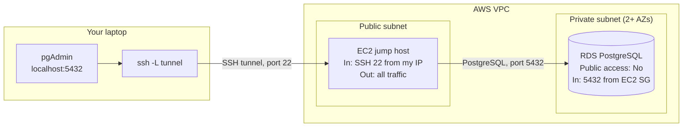

# Accessing a Private RDS PostgreSQL via SSH Tunnel and pgAdmin

A developer can query an RDS PostgreSQL database in a private subnet from their own laptop, using pgAdmin, without exposing the database to the internet. The trick is an EC2 jump host (bastion) in a public subnet and an SSH tunnel through it.

## Contents

- [Overview](#overview)
- [Architecture and traffic flow](#architecture-and-traffic-flow)
- [Key concepts](#key-concepts)
- [Step-by-step setup](#step-by-step-setup)
- [The SSH tunnel](#the-ssh-tunnel)
- [Connecting with pgAdmin](#connecting-with-pgadmin)
- [Least-privilege app database and user](#least-privilege-app-database-and-user)
- [Errors and fixes](#errors-and-fixes)
- [Security practices and next steps](#security-practices-and-next-steps)

## Overview

**The problem:** RDS sits in a private subnet with no public IP, so a laptop on the internet cannot reach it directly. Making RDS public would solve access but would also expose the database to anyone scanning the internet.

**The solution:**

- An EC2 instance in a public subnet of the same VPC acts as the jump host.
- The laptop opens an SSH connection to that EC2 on port 22.
- SSH local port forwarding carries database traffic from `localhost:5432` on the laptop, through the EC2, to RDS on port 5432.
- pgAdmin on the laptop connects to `localhost:5432` as if the database were local.

Only the EC2 is reachable from outside, only on port 22, and only from the developer's IP.

## Architecture and traffic flow



A query travels in four hops:

1. pgAdmin sends it to `localhost:5432` on the laptop.
2. The SSH client wraps it and sends it to the EC2 jump host on port 22.
3. The EC2 forwards it to the RDS endpoint on port 5432 inside the VPC.
4. The reply returns the same way, back to pgAdmin.

## Key concepts

| Concept | What it means | In this setup |
| --- | --- | --- |
| Public subnet | Subnet with a route to an internet gateway | Holds the EC2 jump host |
| Private subnet | Subnet with no direct route from the internet | Holds RDS |
| Availability Zone (AZ) | A separate data center within a region, with its own power and network | RDS needs subnets in 2+ AZs |
| DB subnet group | The set of subnets RDS is allowed to place a database in | Private subnets in at least two AZs |
| Security group | A stateful virtual firewall attached to an instance | One for EC2, one for RDS |
| Inbound rule | Who can connect to the resource | EC2: port 22 from my IP. RDS: port 5432 from EC2's security group |
| Outbound rule | Where the resource can connect to | EC2 default: all traffic to 0.0.0.0/0 |
| Port | A numbered door on a machine | 22 = SSH, 5432 = PostgreSQL |
| Jump host (bastion) | A small server that is the only way into the private network | EC2 instance, for example t3.micro |

**Why two AZs for RDS:** AWS requires the DB subnet group to span at least two AZs, even for a Single-AZ database. A Multi-AZ standby needs the second AZ, and it lets you switch to Multi-AZ later without changing the subnet group. A Single-AZ database still runs in only one subnet.

**Security groups are stateful:** if an inbound connection is allowed, its reply goes back automatically. No outbound rule is needed for responses.

**Subnet group name:** a DB subnet group cannot be renamed after creation. To get your own name, create it first under RDS > Subnet groups, then choose "Choose existing" while creating the database.

## Step-by-step setup

1. **Create the RDS PostgreSQL database**
    - Place it in the VPC's private subnets, with Public access set to No.
    - Use the default DB subnet group, or create your own named one first (private subnets in at least two AZs).
    - Note the master username and password.
2. **Create the EC2 jump host**
    - Amazon Linux 2023 or Ubuntu, a small instance such as t3.micro.
    - Same VPC as RDS, in a public subnet, with auto-assign public IP on. An Elastic IP keeps the address fixed across restarts.
    - Create or choose a key pair and keep the `.pem` file safe.
    - Shortcut: on the RDS creation page, "Connect to an EC2 compute resource" sets up the RDS security group rule automatically.
3. **Configure security groups**
    - EC2 inbound: SSH, port 22, source My IP (never 0.0.0.0/0).
    - RDS inbound: PostgreSQL, port 5432, source = EC2's security group.
    - EC2 outbound: the default all-traffic rule is enough.
4. **Collect connection details**
    - EC2 public IP and the `.pem` key.
    - RDS endpoint and port, from RDS > Databases > your DB > Connectivity & security.
    - Database username and password.
5. **Start the SSH tunnel** from the laptop (next section).
6. **Connect pgAdmin** to `localhost:5432`.

**Security groups the console creates for you:**

- `launch-wizard-1`: made by the EC2 launch wizard when you choose "Create security group". It usually holds the SSH rule. Check that its SSH source is My IP, because the wizard often defaults to Anywhere.
- `ec2-rds-1` and `rds-ec2-1`: made by the RDS "connect to EC2" option. They reference each other. Their description warns about connection loss, which only matters while the database and EC2 exist.
- An instance with several security groups gets the combined rules of all of them.

To check the jump host's OS, run `cat /etc/os-release` or `hostnamectl`.

## The SSH tunnel

One command on the laptop opens the tunnel; it stays running until you stop it.

```bash
ssh -i mykey.pem -N -L 5432:<rds-endpoint>:5432 ec2-user@<ec2-public-ip>
```

| Part | Meaning |
| --- | --- |
| `ssh` | The normal SSH client |
| `-i mykey.pem` | Private key file used to log in to the EC2 |
| `-N` | Do not open a shell on the EC2, only keep the tunnel open |
| `-L 5432:<rds-endpoint>:5432` | Local forwarding: laptop port 5432 goes to RDS endpoint port 5432 |
| `ec2-user@<ec2-public-ip>` | User and public IP of the jump host (`ubuntu` on Ubuntu AMIs) |

**The two 5432s:** the first is the port opened on the laptop and can be any free port, such as 5433 if local Postgres already uses 5432. The second must match the RDS port, which is 5432 unless changed at creation.

**What you see when it works:**

- First run only: "Permanently added ... to the list of known hosts". SSH saved the EC2's identity.
- Then a blinking cursor with no output. This is normal because of `-N`; the tunnel is running.
- Keep that window open while you work. Press Ctrl + C to close the tunnel.
- After a laptop restart or closing the window, run the same command again.

**One tunnel, many connections:** the tunnel is only a path. The master user and the app user can both connect through it at the same time.

On Windows, a "permissions too open" error on the key means the `.pem` file must be readable only by your user (Properties > Security).

## Connecting with pgAdmin

pgAdmin is the UI client developers use to query the database. There are two ways to connect.

**Option A: through the running SSH tunnel (what we used)**

| Field (Register > Server) | Value |
| --- | --- |
| Host | `localhost` |
| Port | `5432` (or the local port you chose) |
| Maintenance database | `postgres` |
| Username / Password | Database credentials, not the EC2 login |
| SSH Tunnel tab | Off, the terminal tunnel already does this |

**Option B: pgAdmin's built-in SSH tunnel (no terminal)**

- Connection tab: Host = RDS endpoint, Port = 5432, plus database username and password.
- SSH Tunnel tab: on, Tunnel host = EC2 public IP, Port = 22, Username = `ec2-user`, Identity file = the `.pem` key.
- DBeaver and MySQL Workbench ("Standard TCP/IP over SSH") offer the same built-in option.

**Maintenance database:** the database pgAdmin connects to first, to read the list of all other databases. Keep it as `postgres`, which exists on every PostgreSQL server. It does not limit which databases you can open.

**What the tree shows:**

- A red icon on a database means pgAdmin has not opened a connection to it yet. Click it to connect.
- If a click gives "permission denied" or "does not have CONNECT privilege", the user is blocked from that database by design.
- `rdsadmin` is an AWS-managed database for RDS internals. No user can open it, not even the master user.

**Browser-based clients:** the AWS console Query Editor works only with Aurora (with the Data API), not standard RDS PostgreSQL. For a browser client, run pgAdmin 4 web or CloudBeaver in Docker on the EC2 and reach it through an SSH tunnel on port 8080. Never open 8080 to the internet.

## Least-privilege app database and user

The application connects as a normal user that owns only its own database; the master user is kept for admin work. If the app's credentials leak, the damage stays inside one database.

Run each statement on its own in pgAdmin's Query Tool on the `postgres` database, connected as the master user (select one line, then F5):

```sql
CREATE USER myapp_user WITH PASSWORD '<your-password>';
```

```sql
GRANT myapp_user TO postgres;
```

```sql
CREATE DATABASE myapp_db OWNER myapp_user;
```

```sql
REVOKE CONNECT ON DATABASE myapp_db FROM PUBLIC;
```

| Statement | Why |
| --- | --- |
| `CREATE USER` | A normal role with no admin rights |
| `GRANT myapp_user TO postgres` | Makes the master user a member of the app role, required on RDS (all versions) to assign ownership, because the master user is not a true superuser. The app user gains nothing from it |
| `CREATE DATABASE ... OWNER` | The app user can create tables in its own database only |
| `REVOKE CONNECT ... FROM PUBLIC` | Other users cannot connect to the app database |

**About `GRANT myapp_user TO postgres`:** in PostgreSQL, users and groups are both roles. This line lets `postgres` act as `myapp_user` (SET ROLE). Permission flows from `myapp_user` to `postgres`, never the other way. It is like an authorization letter to act on a friend's behalf: you can act for them, they get no access to your account.

**Verify with a second pgAdmin connection** (same tunnel, Maintenance database `myapp_db`, Username `myapp_user`):

- `CREATE TABLE test (id serial PRIMARY KEY, name text);` should work.
- `CREATE DATABASE another_db;` should fail with "permission denied", proof the user is limited.
- If the master user also needs to open `myapp_db`, run `GRANT CONNECT ON DATABASE myapp_db TO postgres;`.

**App connection string (.NET / Npgsql):**

```
Host=<rds-endpoint>;Port=5432;Database=myapp_db;Username=myapp_user;Password=<from secrets>
```

Keep the password out of code: use user secrets, environment variables or AWS Secrets Manager.

## Errors and fixes

| Error or symptom | Cause | Fix |
| --- | --- | --- |
| Security group "will not be deleted", 1 security group associated | Another group's rule still references it (`ec2-rds-1` and `rds-ec2-1` reference each other) | Remove the cross-referencing inbound and outbound rules from both, then delete both |
| Security group still won't delete after removing rules | A leftover network interface is attached | EC2 > Network Interfaces, filter by the group, delete an "available" interface first |
| "Modification could lead to connection loss" | Only the auto-written description of the group | Ignore it once the database and EC2 it served are gone |
| `CREATE DATABASE cannot run inside a transaction block` | pgAdmin ran several statements together in one transaction | Select and run `CREATE DATABASE` on its own |
| `must be able to SET ROLE "myapp_user"` | On RDS the master user is not a true superuser; only a member of a role can make it a database owner. PostgreSQL 16+ words the error as SET ROLE; older versions say "must be member of role" | `GRANT myapp_user TO postgres;` then create the database |
| `role "myapp_user" already exists` | The CREATE USER line already ran on an earlier attempt | Skip it and continue |
| Tunnel window shows only a blinking cursor | Normal with `-N` | Leave it open and connect from pgAdmin |
| Connection hangs or times out | Usually a security group rule | Recheck port 22 from your IP on EC2 and port 5432 from EC2's group on RDS |

## Security practices and next steps

**Practices to keep:**

- RDS stays in private subnets with Public access set to No.
- SSH on the jump host is open only to specific IPs (/32), never 0.0.0.0/0, because bots scan constantly for open port 22.
- RDS accepts 5432 only from the jump host's security group, not from IP ranges.
- Applications use their own least-privilege user; the master user is for admin work only.
- Use a non-default master username for production databases instead of `postgres`.
- Keep `.pem` keys and database passwords out of code, chats and screenshots.
- Before sharing a screenshot, check it shows no endpoint, IP, connection string or password.
- Give each security group a clear name (`bastion-sg`, `rds-sg`) instead of wizard names. Groups cannot be renamed, so name them at creation. Terraform lets you set the name explicitly.

**Alternatives to a public jump host:**

- AWS Systems Manager Session Manager port forwarding: the EC2 can sit in a private subnet, with no SSH keys and no open port 22.
- AWS Client VPN: suits a whole team that needs network-level access.

**Next steps:**

- [ ] Create a named DB subnet group manually and compare it with the default one
- [ ] Try a browser-based client (pgAdmin web or CloudBeaver) on the EC2 through a tunnel
- [ ] Try Session Manager port forwarding instead of SSH
- [ ] Rebuild the setup with Terraform using clear resource names
