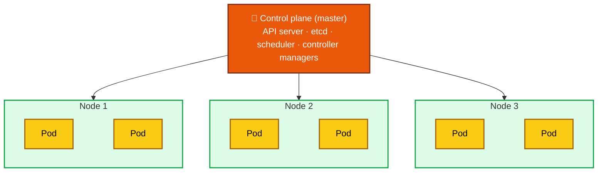

# Kubernetes Cluster Components

A Kubernetes cluster has two main parts:

- **Control plane** (people used to call it the *master*). This is the brain. It decides what runs where.
- **Nodes** (worker machines). This is where your apps actually run, inside Pods.

On top of these, most clusters also install a few **add-ons** for things like DNS and logging.

---

## Control plane (master)

The control plane is made up of these pieces. Together they manage the whole cluster.

**kube-apiserver**
The front door of the cluster. Everything goes through it: `kubectl`, the other control plane parts, and the kubelet on every node. Nothing talks to the cluster without going through the API server.

**etcd**
The cluster's database. It stores the full state of the cluster: which Deployments exist, how many Pods there should be, config, secrets and so on. Only the API server reads from and writes to it.

**kube-scheduler**
When a new Pod needs to run, the scheduler picks the best node for it, based on free CPU and memory and any rules you've set.

**kube-controller-manager**
Keeps checking that what's actually running matches what you asked for. If you asked for 3 Pods and one crashes, it notices and creates a new one.

**cloud-controller-manager**
Talks to the cloud provider. For example, when you create a `LoadBalancer` Service on GKE, this is what asks Google Cloud for a real load balancer.

> **Note:** The slide lists "Control Plane" as just the scheduler and controller managers. In practice the API server and etcd are part of the control plane too.

### How many control plane machines?

In a self-managed production cluster you usually run **3 or 5** control plane machines, always an **odd number**. etcd needs a majority (more than half) of its members to agree before it saves anything, so an odd number gives the best fault tolerance:

| Control plane machines | Can survive losing |
|---|---|
| 1 | 0 (no high availability) |
| 3 | 1 |
| 5 | 2 |
| 7 | 3 |

### On GKE

On GKE, Google runs the control plane for you. You don't get a VM for it, you can't SSH into it, and it won't show up in `kubectl get nodes`. You only see and pay for the worker nodes.

---

## Nodes (workers)

Each node runs three things:

**kubelet**
The agent on the node. It watches the API server for Pods assigned to its node, starts them, and keeps reporting whether they're healthy.

**kube-proxy**
Sets up network rules on the node so traffic sent to a Service ends up at the right Pod.

**Container runtime**
The software that actually runs the containers. On GKE this is containerd.

A cluster can have anything from one node to thousands. Kubernetes officially supports up to 5,000 nodes in a single cluster.

---

## Add-ons

These aren't part of core Kubernetes, but almost every real cluster has them.

**DNS (CoreDNS)**
Lets Pods find each other by name. Your app can call `http://orders-service` instead of hard-coding an IP address.

**Web UI (Dashboard)**
A browser-based view of the cluster. On GKE you'd normally use the Google Cloud Console instead, under *Kubernetes Engine → Workloads*.

**Container resource monitoring**
Collects CPU and memory usage for nodes and Pods. `metrics-server` is what makes `kubectl top` work, and Prometheus or Google Cloud Monitoring are used for dashboards and alerts.

**Cluster-level logging**
Collects logs from every container and sends them to one central place, so you can still read them after a Pod is gone. On GKE they go to Cloud Logging automatically.

---

## In one line

The control plane decides, the nodes do the work, and add-ons fill the gaps for DNS, monitoring and logging.

See also: [Kubernetes Node](./kubernetes-node.md) · [Kubernetes Basic Concepts](./kubernetes-basic-concepts.md)
