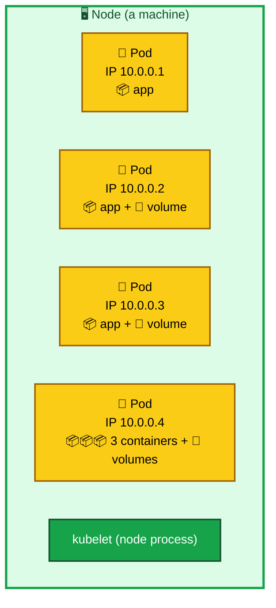

# Kubernetes Basic Concepts

In a Kubernetes cluster, your apps are spread across many **nodes** (machines).
To understand how that works, you need four basic ideas: **Pods, Services, Volumes and Namespaces**.

---

## Picture it



One node runs many Pods. Each Pod has its own IP address and holds one or more containers.
The **kubelet** on the node looks after all of them.

---

## 1. Pod — the box your container lives in

- A Pod is the **smallest thing Kubernetes runs**. You don't run a container directly; you run a Pod, and the container lives inside it.
- Usually **one Pod = one container** (your app). Sometimes a Pod has a small helper container too.
- Containers in the same Pod **share the same IP address and storage**, so they can talk to each other on `localhost`.
- Pods are **temporary**. If one dies, Kubernetes creates a new one with a **new IP**.

> Think of it like: a **lunch box** (Pod) with your **food** (container) inside.

## 2. Service — a fixed address for your Pods

- Pods come and go, and their IPs keep changing. So how do users or other apps find them?
- A **Service** gives a group of Pods **one stable name and IP**, and spreads traffic across them (load balancing).
- It is the **front door** of your app. Users and other apps talk to the Service, never to a Pod directly.

> Think of it like: a company's **main phone number**. Employees (Pods) change, but the number stays the same.

## 3. Volume — storage that survives

- A container's own files are **lost when it restarts**.
- A **Volume** is storage attached to a Pod, so data can **survive restarts** and be **shared** between containers in the Pod.
- For data that must live even after the Pod is deleted (like a database), use a **PersistentVolume** (on GKE, this is a Google Cloud disk).

> Think of it like: an **external hard drive**. You can replace the laptop, the data is still there.

## 4. Namespace — separate rooms inside one cluster

- A **Namespace** divides one cluster into **separate sections**.
- Used to keep things apart by **team** or **environment** (e.g. `team-a`, `team-b`, `stage`, `prod`).
- Names only need to be unique **inside** a namespace, so two teams can both have a Service called `api`.
- You can set **access rules** and **resource limits** per namespace.

> Think of it like: **folders** on a computer. Same file name can exist in two different folders.

---

## Quick summary

| Concept | One-line meaning |
|---------|------------------|
| **Pod** | Smallest unit; wraps your container(s); has its own IP; temporary. |
| **Service** | Stable address + load balancer in front of a group of Pods. |
| **Volume** | Storage for a Pod so data isn't lost on restart. |
| **Namespace** | Divides the cluster into separate sections (by team/environment). |

## Commands to try

```bash
kubectl get pods                 # list Pods
kubectl get pods -o wide         # + Pod IP and which node it's on
kubectl get svc                  # list Services
kubectl get pvc                  # list storage claims (volumes)
kubectl get namespaces           # list Namespaces
kubectl get pods -n <namespace>  # Pods in a specific namespace
```

See also: [Kubernetes Node](./kubernetes-node.md) · [How Applications Deploy in Kubernetes — Basics](./how-apps-deploy-in-kubernetes-basics.md)
