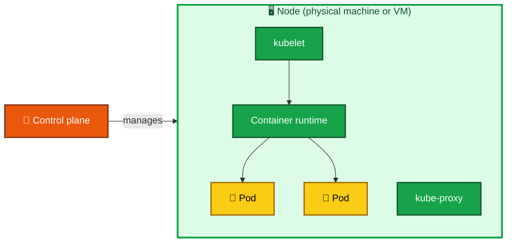

# Kubernetes Node

A **Node** is a **worker machine** in a Kubernetes cluster. Your application Pods run on nodes.

## Key points

| # | Point |
|---|-------|
| 1 | A node is the **main worker machine** of the cluster. |
| 2 | Old name: **minions** (no longer used, today they're just called *nodes* / *worker nodes*). |
| 3 | It can be a **physical machine** or a **VM** (on GKE, each node is a Compute Engine VM). |
| 4 | It provides all the **services needed to run Pods**. |
| 5 | It is managed by the **control plane** (older term: *master*). |

> A single Kubernetes cluster officially supports up to **5,000 nodes**.

## Worker node vs control plane node

The control plane (old name: *master*) also runs on machines, and those machines are **nodes too**.
So a cluster has two kinds of nodes:

| | **Control plane node** (old: master node) | **Worker node** |
|---|---|---|
| Job | Manages the cluster | Runs your application Pods |
| Runs | kube-apiserver, etcd, scheduler, controller-manager | kubelet, container runtime, kube-proxy |
| App Pods? | No, blocked by a taint (`node-role.kubernetes.io/control-plane:NoSchedule`) | Yes |
| In `kubectl get nodes` | Shows with role `control-plane` | Shows with role `<none>` |

```bash
$ kubectl get nodes        # self-managed cluster (e.g. kubeadm)
NAME       STATUS   ROLES           AGE   VERSION
cp-1       Ready    control-plane   10d   v1.34.1
worker-1   Ready    <none>          10d   v1.34.1
worker-2   Ready    <none>          10d   v1.34.1
```

> **On GKE / EKS / AKS (managed Kubernetes)** the cloud provider runs the control plane for you.
> You never see those machines, so `kubectl get nodes` shows **only worker nodes**.

When people just say "node", they usually mean a **worker node**.

## Components on every worker node

| Component | Role |
|-----------|------|
| **kubelet** | Agent that talks to the control plane and makes sure assigned Pods are running and healthy. |
| **Container runtime** | Actually runs the containers (e.g. containerd). |
| **kube-proxy** | Sets up network rules so Service traffic reaches the right Pods. |



## Useful commands

```bash
kubectl get nodes                 # list nodes and their status
kubectl get nodes -o wide         # + internal IP, OS, runtime
kubectl describe node <node-name> # capacity, conditions, pods on it
kubectl top node                  # CPU / memory usage (needs metrics-server)
```

## One-line summary

> A node is a worker machine (physical or VM), managed by the control plane, that runs Pods using kubelet, a container runtime and kube-proxy.

See also: [How Applications Deploy in Kubernetes — Basics](./how-apps-deploy-in-kubernetes-basics.md)
