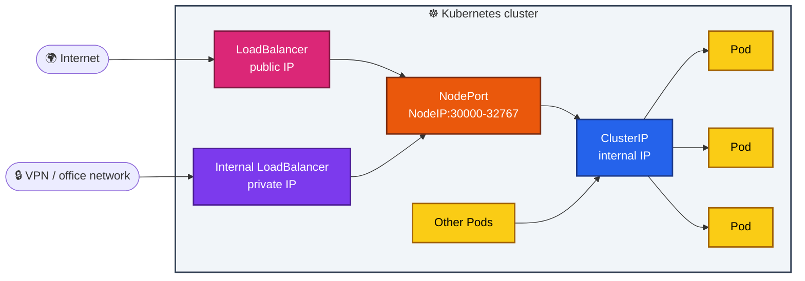

# Kubernetes Service Types

Pods come and go, and every new Pod gets a new IP address. A **Service** gives a group of Pods **one stable name and IP**, and spreads traffic across them.

The **type** of a Service decides **who can reach it**: only things inside the cluster, your private network, or the whole internet.

> **Behind the scenes:** kube-proxy (or Cilium on GKE Dataplane V2) runs on every node and sets up the network rules that make every Service type work.

---

## The big picture



Each type builds on the one below it:

```
LoadBalancer  →  NodePort  →  ClusterIP  →  Pods
```

So when you create a LoadBalancer, Kubernetes also creates a NodePort and a ClusterIP for you.

---

## 1. ClusterIP (the default)

- Gets a fixed IP that works **only inside the cluster**.
- Other Pods can call it by name, e.g. `http://payment-api`.
- Nothing outside the cluster can reach it, not even over VPN.

**Use it for:** services talking to each other inside the cluster. Almost every app has one.

## 2. NodePort

- Opens the same port (between **30000 and 32767**) on **every node**.
- You reach it from outside with `<NodeIP>:<NodePort>`.

**Use it for:** testing and learning. Rarely used in production, because node IPs change and the port numbers are awkward.

## 3. LoadBalancer

- Asks the cloud provider for a **real load balancer with a public IP**. On GKE, this is a Google Cloud Network Load Balancer.
- Anyone on the internet can reach it.

**Use it for:** exposing a single app directly to the internet.
**Downside:** every Service gets its own load balancer, and each one costs money.

## 4. ExternalName

- Doesn't point to any Pods. It's just a **DNS alias** to something outside the cluster.
- For example, `db` inside the cluster → `mydb.example.com` outside.

**Use it for:** giving an external system a simple in-cluster name.

## Bonus: Headless Service

- Set `clusterIP: None`. There's no Service IP; DNS returns the **Pod IPs directly**.

**Use it for:** StatefulSets and databases, where you need to talk to a specific Pod.

---

## Internal LoadBalancer: private access only (VPN)

What if your API should be reachable **only from your company network or VPN**, not from the internet?

Use a **LoadBalancer with the "Internal" annotation**. It gets a **private IP inside your VPC** instead of a public one. Anyone connected to the VPN can reach it; the internet can't.

```yaml
apiVersion: v1
kind: Service
metadata:
  name: myapi-internal
  annotations:
    networking.gke.io/load-balancer-type: "Internal"
    # Needed if the VPN connects in a different region:
    networking.gke.io/internal-load-balancer-allow-global-access: "true"
spec:
  type: LoadBalancer
  selector:
    app: myapi
  ports:
    - port: 80
      targetPort: 8080
  # Optional: only allow these IP ranges (e.g. your VPN range)
  loadBalancerSourceRanges:
    - 10.20.0.0/16
```

After `kubectl get svc`, the `EXTERNAL-IP` column shows a **private IP** like `10.x.x.x`.

**Why the other types don't fit here:**

| Type | Problem |
|---|---|
| ClusterIP | Only works inside the cluster. VPN users can't reach it. |
| NodePort | Node IPs change, odd port numbers. Not production-friendly. |
| Normal LoadBalancer | Public IP, so it's open to the whole internet. |

---

## Ingress / Gateway (not a Service type, but used with Services)

A LoadBalancer gives **one app** its own load balancer. An **Ingress** or **Gateway** puts **one load balancer in front of many apps** and routes HTTP traffic by path or domain:

```
api.company.com/orders  →  orders Service (ClusterIP)
api.company.com/users   →  users Service  (ClusterIP)
```

- Handles **HTTPS and SSL certificates** in one place.
- On GKE, it creates a Google Cloud **HTTP(S) Load Balancer**.
- For **private** access, use an internal one: Ingress class `gce-internal` or Gateway class `gke-l7-rilb`. This needs a **proxy-only subnet** in the VPC.

**This is the most common production setup:** Ingress/Gateway at the edge, and a ClusterIP Service behind it for each app.

---

## Quick comparison

| Type | Who can reach it | Typical use |
|---|---|---|
| **ClusterIP** | Only inside the cluster | Service-to-service calls (most common) |
| **NodePort** | `NodeIP:30000–32767` | Testing |
| **LoadBalancer** | Internet (public IP) | Exposing one app publicly |
| **Internal LoadBalancer** | Your VPC / VPN (private IP) | Private APIs |
| **ExternalName** | DNS alias | Pointing to an outside system |
| **Headless** | Pod IPs directly | StatefulSets, databases |
| **Ingress / Gateway** | Internet or private, one LB for many apps | Web apps and APIs in production |

**Which one should I pick?**

- Only other apps in the cluster call it → **ClusterIP**
- Public, one app → **LoadBalancer**
- Public, many apps or HTTPS routing → **Ingress / Gateway**
- Private (VPN only), one app → **Internal LoadBalancer**
- Private, many apps or HTTPS routing → **Internal Ingress / Gateway**

---

## Basic Service YAML

```yaml
apiVersion: v1
kind: Service
metadata:
  name: myapi
spec:
  type: ClusterIP        # or NodePort / LoadBalancer
  selector:
    app: myapi           # sends traffic to Pods with this label
  ports:
    - port: 80           # port the Service listens on
      targetPort: 8080   # port the container listens on
```

## Useful commands

```bash
kubectl get svc                     # list Services (TYPE column shows the type)
kubectl get svc -o wide             # + selector
kubectl describe svc <name>         # details, including which Pod IPs it sends to
kubectl get endpointslices          # the actual Pod IPs behind each Service
kubectl port-forward svc/<name> 8080:80   # test a ClusterIP Service from your laptop
```

---

## In one line

ClusterIP is for inside the cluster, LoadBalancer is for outside, Internal LoadBalancer is for your private network, and Ingress/Gateway puts many apps behind one load balancer.

See also: [Kubernetes Basic Concepts](./kubernetes-basic-concepts.md) · [Kubernetes Namespaces](./kubernetes-namespaces.md)
