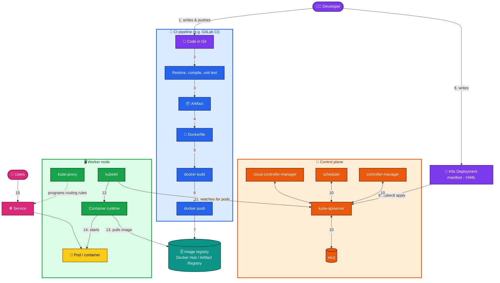

# How Applications Deploy in Kubernetes — Basics

End-to-end flow of an application, from the developer's code to a running container that users can reach.

> Next: [Advanced notes](./how-apps-deploy-in-kubernetes-advanced.md)

The flow has two halves:

- **CI (Continuous Integration):** code → build (compile) → test → publish (artifact) → container image → registry
- **CD / Kubernetes:** manifest → control plane → node → running pod → users

---

## Flow diagram



**Colour legend:** Purple = developer & files · Blue = CI pipeline · Teal = image registry · Orange = control plane · Green = worker node · Yellow = running pod · Pink = users & Service

---

## Step by step

### Part 1: CI (build the image)

| Step | What happens |
|------|--------------|
| 1 | Developer writes code and pushes it to Git. The push triggers the pipeline. |
| 2 | Pipeline **compiles** the code first (`dotnet restore` → `dotnet build`), then runs **unit tests** on the compiled code (`dotnet test`). If a test fails, the pipeline stops here. |
| 3 | After tests pass, `dotnet publish` produces the deployable **artifact**. |
| 4 | The **Dockerfile** (committed in the repo alongside the code) describes how to package the artifact. |
| 5 | `docker build` creates a **container image**. |
| 6–7 | `docker push` uploads the image to a **registry** (Docker Hub, Google Artifact Registry, GitLab Container Registry, etc.). |

> **Order matters:** restore → build (compile) → test → publish → docker build → push.
> Tests need compiled code, so compile comes first. But the **Docker image** is built only *after* tests pass, so a broken build never reaches the registry.

### Part 2: Kubernetes (run the image)

| Step | What happens |
|------|--------------|
| 8 | Developer writes a **Deployment manifest** (YAML): image name, replicas, ports, resources. |
| 9 | `kubectl apply -f deployment.yaml` sends the manifest to the **API server**. |
| 10 | Control plane works out the desired state (details below). |
| 11 | **kubelet** on the node sees a pod assigned to its node. |
| 12 | kubelet tells the **container runtime** (containerd) to run the container. |
| 13 | Container runtime **pulls the image** from the registry. |
| 14 | Container starts inside the **Pod**. |
| 15 | **Users** reach the app through a **Service**. |

---

## Control plane components (step 10)

| Component | Role |
|-----------|------|
| **kube-apiserver** | Front door of the cluster. Every component and `kubectl` talks only to it. |
| **etcd** | Key-value store holding the whole cluster state. **Only the API server talks to etcd.** |
| **controller-manager** | Runs controllers that keep actual state = desired state (Deployment → ReplicaSet → Pods). |
| **scheduler** | Picks which node each new pod should run on (based on CPU, memory, rules). |
| **cloud-controller-manager** | Talks to the cloud provider (e.g. creates a GCP load balancer for a `LoadBalancer` Service). |

## Node components

| Component | Role |
|-----------|------|
| **kubelet** | Agent on every node. Makes sure the pods assigned to the node are running and healthy. |
| **container runtime** | Actually runs containers (containerd on GKE). |
| **kube-proxy** | Sets up networking rules so Service traffic reaches the right pods. |

---

## Simple multi-stage Dockerfile (.NET)

The app is built inside Docker itself, in two stages:

```dockerfile
# Stage 1: build
FROM mcr.microsoft.com/dotnet/sdk:10.0 AS build
WORKDIR /src
COPY . .
RUN dotnet publish -c Release -o /app/publish

# Stage 2: runtime (small image, no SDK)
FROM mcr.microsoft.com/dotnet/aspnet:10.0
WORKDIR /app
COPY --from=build /app/publish .
ENTRYPOINT ["dotnet", "MyApi.dll"]
```

- **Stage 1** uses the big SDK image to compile and publish the app.
- **Stage 2** starts fresh from the small runtime image and copies only the published output.
- Result: the final image has no SDK and no source code, only what's needed to run.

---

## Quick commands

```bash
# Build and push image
docker build -t <registry>/<app>:<tag> .
docker push <registry>/<app>:<tag>

# Deploy
kubectl apply -f deployment.yaml

# Check
kubectl get deployments
kubectl get pods -o wide
kubectl describe pod <pod-name>
kubectl logs <pod-name>
kubectl get svc
```

---

## One-line summary

> CI turns code into an image in a registry. Kubernetes reads the manifest, stores it in etcd, schedules a pod onto a node, and the kubelet pulls the image and runs it; a Service exposes it to users.
